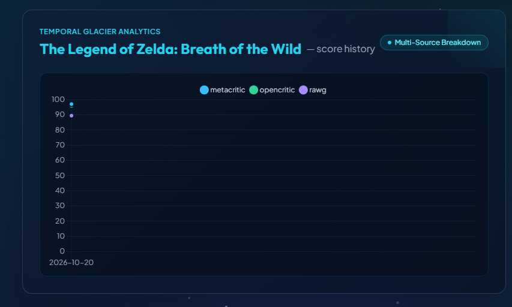
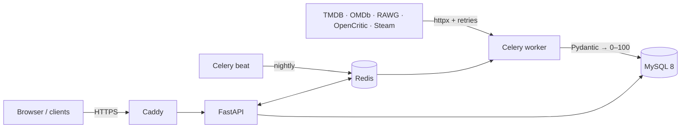

# ScoreSync


A public API that unifies critic and user review scores for movies, TV, and games
from IMDb, Rotten Tomatoes, Metacritic, OpenCritic, and Steam onto one 0–100 scale.

**Live demo:** https://scoresync.store · **API docs:** https://api.scoresync.store/docs · **Video:** [2-minute walkthrough](LINK)



## Architecture



## Highlights
- [400] titles across movies, TV, and games, refreshed nightly from five sources
- Scores normalized to 0–100; user scores use a Bayesian average so small samples can't top the charts
- Score history stored as snapshots, so scoring changes are rebuilt without re-fetching
- Redis caching: p95 [X] ms with cache vs [Y] ms without (k6, 20 virtual users)
- Docker Compose on AWS Lightsail behind Caddy (automatic HTTPS), with push-to-deploy and post-deploy smoke tests

## Testing
| Layer | Tools | Tests |
| --- | --- | --- |
| Unit | pytest, Hypothesis (property-based), boundary-value and decision-table tests | [N] |
| Contract | Recorded and live checks of every source API's response shape | [N] |
| Integration | Testcontainers MySQL/Redis; Schemathesis fuzzing from the OpenAPI spec | [N] |
| End-to-end | Playwright with page objects, network stubbing, XSS and outage cases | 4 |
| Production | Post-deploy smoke tests; nightly data-quality checks | 4 + 5 checks |

- **Coverage:** 76% branch coverage, enforced in CI with a ratchet
- **Mutation score:** 97% on the scoring logic (3 documented equivalent mutants)
- **Security:** OWASP ZAP API scan (118 passed, 0 failed), nightly pip-audit, gitleaks pre-commit hook
- **Nightly CI:** live API contracts, deep fuzzing, mutation gate, dependency audit, production data quality

Risk analysis and full bug log: [docs/TEST_STRATEGY.md](docs/TEST_STRATEGY.md) · Security decisions: [docs/SECURITY_REVIEW.md](docs/SECURITY_REVIEW.md)

## Bugs found by testing
[6] issues found and fixed, each guarded by a regression test. Highlights:
- **XSS on the demo page:** API-supplied titles were rendered as HTML; caught by a Playwright regression test
- **Silent blank scores:** duplicate enum classes made every cached score NULL, with no error raised
- **Concurrency race:** parallel ingest jobs collided on new genres under REPEATABLE READ
- **A rate limiter that limited nothing:** a library silently stopped working under new FastAPI routing
- **500 on huge page numbers:** found by Schemathesis fuzzing (MySQL OFFSET overflow)
- **Vulnerable dependency:** nightly pip-audit flagged certifi the day its advisory was published; patched and deployed the same day

## Design decisions
- **Official APIs instead of scraping** review sites: terms of service and reliability
- **Decimal scores** for exact rounding; **snapshots** for score history
- **Rankings count only contributing sources:** real data showed the original rule emptied the TV leaderboard
- **Honest failure states:** the demo page shows an error during outages rather than placeholder data

## Run it locally
```bash
cp .env.example .env    # add your API keys
docker compose up -d --build --wait
# API docs at http://localhost:8000/docs
```

## Data attribution
Data from TMDB, OMDb, RAWG, OpenCritic, and Steam. This product uses the TMDB API but is not endorsed or certified by TMDB.
